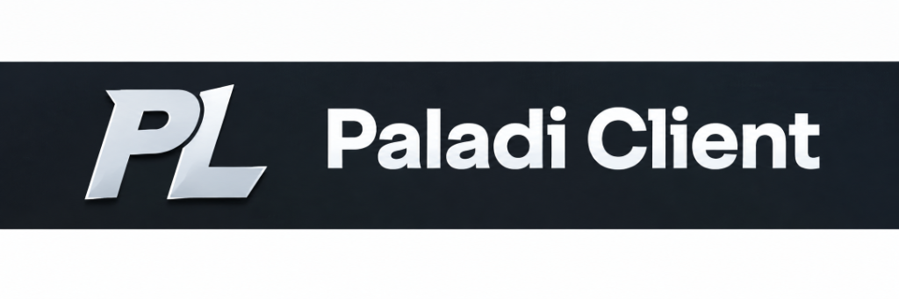



  

  <b>IT Engineer · Minecraft Server Developer · Web & Automation</b> 
  <code>BUILD</code> · <code>OPTIMIZE</code> · <code>AUTOMATE</code>

  <i>I build and operate practical systems — from Minecraft server features and web administration to internal workflow automation.</i>

  
  

---

## 🟩 Featured Experience

### 🐾 **[MeowSMP.net](https://meowsmp.net/)** — *Minecraft Server Developer* `(2024 - Present)`
> **[MeowSMP.net](https://meowsmp.net/)** is a Vietnamese Minecraft Slimefun server where technology, automation, and community gameplay come together.
* ⚡ **Slimefun Plugins & Addons:** Develop, customize, and optimize Slimefun mechanics and addons.
* 🔧 **Custom Feature Engineering:** Modify and adapt existing plugins for server-specific features and operational requirements.
* 🛡️ **Troubleshooting & Performance:** Diagnose and resolve plugin compatibility, performance bottlenecks, and gameplay-system issues.
* 🌐 **Technical Operations:** Support the end-to-end technical operation of the Minecraft server infrastructure and its web presence.

---

### ⚔️ **[Paladi Client](https://github.com/DragonGod655/paladiclient)** — *Lead Developer & Creator*
> High-performance utility client for Minecraft (Fabric 1.21+), engineered for automation, smart pathfinding, and seamless anti-cheat bypass mechanics.
* 🚀 **Custom Combat & Utility Modules:** AutoTotem, AutoMine, SpawnerProtect, SusChunkFinder, and Freecam.
* 🗺️ **Integrated Pathing & Automation:** Deep integration with Baritone pathfinding, Litematica schematics, and auto-sorting workflows.
* 🖥️ **Control Hub & Web UI:** Built-in dashboard and automation control tools.

---

## 🛠️ What I Work On

* 🎮 **Minecraft Development:** Java plugin customization, Slimefun addons, Fabric client mods, and server optimization.
* 🌐 **Web Administration:** Website deployment, configuration, and day-to-day operation.
* 🖥️ **Server Administration:** Service configuration, monitoring, maintenance, and incident troubleshooting.
* ⚙️ **Workflow Automation:** Internal tools that eliminate repetitive work and improve operational accuracy.

---

## 💻 Tech Stack & Skills

### 🚀 Programming Languages

### 🧩 Minecraft & Game Tech

### 🧰 Tools & DevOps

---

## 🎓 Education

* 🎓 **Bachelor of Information Technology**  
  **Saigon University (SGU)** · *2022 – 2027 (Expected)*

---

## 📊 GitHub Analytics

  

 

  <picture>
    <source media="(prefers-color-scheme: dark)" srcset="https://raw.githubusercontent.com/DragonGod655/DragonGod655/output/github-contribution-grid-snake-dark.svg" />
    <source media="(prefers-color-scheme: light)" srcset="https://raw.githubusercontent.com/DragonGod655/DragonGod655/output/github-contribution-grid-snake.svg" />
    
  </picture>

---

  ⭐️ <i>Thanks for stopping by! Feel free to explore my repositories and connect with me.</i>

